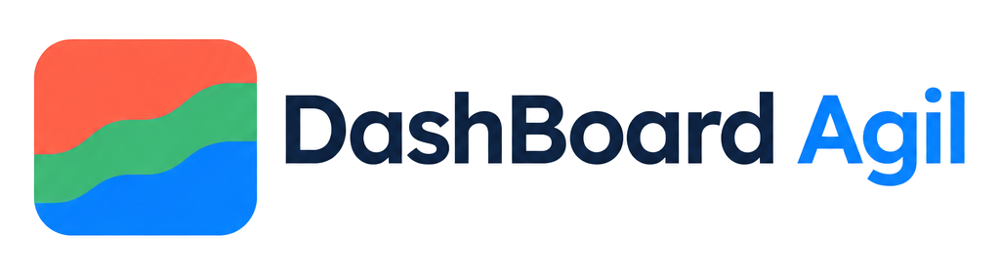
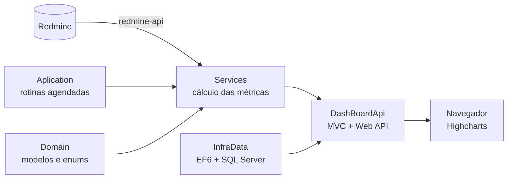

<p align="center">
  <picture>
    <source media="(prefers-color-scheme: dark)" srcset="docs/logo-dark.png">
    
  </picture>
</p>

<p align="center">
  Dashboard de métricas ágeis para times de sustentação: SLA, Cycle Time, Lead Time, Throughput e Cumulative Flow Diagram calculados a partir dos chamados do Redmine.
</p>

<p align="center">
  
  
  
  
  
  
</p>

---

## Sobre

O DashBoard Agil reúne num só lugar as métricas que coordenadores e times de sustentação de software usam para acompanhar o fluxo de trabalho. Ele lê os chamados diretamente do Redmine, agrupa por time e período e mostra em gráficos o que está dentro ou fora do SLA, quanto tempo cada chamado leva, quanto o time entrega e onde o trabalho está acumulando.

O projeto foi desenvolvido em equipe entre junho de 2019 e maio de 2020; o histórico de commits e de branches está preservado neste repositório.

## Métricas e relatórios

| Métrica | O que mostra |
|---|---|
| **SLA** | Chamados dentro e fora do prazo acordado por time, com contagem em horas corridas ou úteis |
| **Cycle Time / Lead Time** | Tempo entre dois status do fluxo, em faixas configuráveis, com distribuição dos chamados |
| **Throughput** | Chamados entregues por período, com linha de tendência (regressão linear) |
| **Taxa de rejeição** | Proporção de chamados rejeitados em relação aos entregues no período |
| **Cumulative Flow Diagram** | Evolução diária da quantidade de chamados em cada fase |
| **Diagrama de dispersão** | Tempo de cada chamado ao longo do período, para identificar outliers |
| **Abertos x Fechados** | Comparação entre demanda que entra e demanda que sai |
| **Prazo de chamados** | Se os chamados de um pacote estão dentro da data prevista |
| **Dia do desenvolvedor** | Esforço registrado por desenvolvedor e por time |
| **Consumo de horas** | Horas lançadas por projeto no período |
| **Desvios e entregas** | Chamados com desvio de fluxo e entregas por versão |

Os gráficos são renderizados com Highcharts e as consultas mais pesadas usam cache de saída na API.

## Funcionalidades

- **Login pelo Redmine:** o usuário entra com as credenciais do próprio Redmine, e o perfil de acesso vem das participações dele nos projetos.
- **Times e subtimes:** projetos do Redmine são agrupados em times, e um time pode ser dividido em subtimes.
- **Configuração de SLA:** cadastro de SLAs por projeto, tipo de chamado e prioridade.
- **Lista de projetos permitidos e bloqueados:** controla quais projetos do Redmine entram no cálculo.
- **Menu e perfis configuráveis:** itens de menu e perfis de cliente definidos em `config.json`.
- **Agente de fechamento automático:** uma rotina agendada dentro da aplicação (`Aplication/Auto.cs`, ligada e desligada pela rota `/api/Agente`) fecha no Redmine os chamados que ficaram em "avaliar produção" além do prazo configurado. O projeto `ConsoleLog` é a versão inicial dessa rotina como aplicativo de console.
- **Log de execução:** registro das ações do agente e das alterações de configuração.

## Arquitetura



```
DashBoardAgil.sln
├── DashBoardAgil.Domain/        Modelos (Chamado, Sla, Fase, Throughput, LeadTime...) e enums de status do Redmine
├── DashBoardAgil.InfraData/     DbContext do Entity Framework 6 e migrations
├── DashBoardAgil.Services/      Integração com o Redmine e cálculo das métricas
├── DashBoardAgil.Aplication/    Rotinas agendadas (agente, cache de CFD e throughput)
├── DashBoardAgil.CrossCutting/  Constantes, criptografia AES, e-mail e utilitários
├── DashBoardAgil.DashBoardApi/  Aplicação web: telas MVC, API REST e scripts de gráficos
├── DashBoardAgil.ConsoleLog/    Versão inicial do agente, como aplicativo de console
└── DashBoardAgil.Tests/         Projeto de testes (MSTest)
```

### Principais rotas da API

Todas seguem o padrão `/api/{controller}` e recebem time, período e filtros pela query string.

| Rota | Métrica |
|---|---|
| `GET /api/SlaControl` | SLA por time ou de todos os times |
| `GET /api/CicleTime` | Cycle Time e Lead Time |
| `GET /api/Throughput` | Throughput por período |
| `GET /api/Rejections` | Taxa de rejeição |
| `GET /api/ComulativeFlowDiagram` | Dados do CFD |
| `GET /api/CreatedClosed` | Abertos x fechados |
| `GET /api/PrazoChamado` | Prazo dos chamados de um pacote |
| `GET /api/DiaDev` | Dia do desenvolvedor |
| `GET /api/ConsumptionHours` | Consumo de horas |
| `GET /api/Entregas` | Entregas por versão |
| `PUT /api/Agente/{id}` | Liga ou desliga o agente de fechamento |

Exemplo:

```http
GET /api/Throughput?time=meu-time&dataIni=2019-01-11&dataFim=2019-03-11
```

### Stack

| Camada | Tecnologia |
|---|---|
| Backend | C#, .NET Framework 4.5, ASP.NET MVC 5.2, Web API 2.2 + OData, RazorEngine |
| Integração | redmine-api (Redmine REST API) |
| Dados | Entity Framework 6.2 (Code First + Migrations), SQL Server / LocalDB |
| Cache | Strathweb CacheOutput |
| Frontend | Razor, Bootstrap 4, jQuery, Font Awesome |
| Gráficos | Highcharts 7, Morris.js |
| Qualidade | SonarQube (análise configurada em `SonarQube.Analysis.Base.xml`) |

### Branches

| Branch | Conteúdo |
|---|---|
| `master` | Versão publicada em produção, com os ajustes finais de 2020 (linha de tendência do throughput) |
| `develop` | Versão mais completa, com as camadas `Domain` e `InfraData`, times e subtimes |
| `feature/*` e demais | Funcionalidades desenvolvidas em paralelo, algumas não mescladas |

## Como executar

### Requisitos

- Windows com Visual Studio 2015 ou superior (workload ASP.NET)
- SQL Server LocalDB ou outra instância SQL Server
- Uma instância do Redmine com a API REST habilitada

### Passos

1. Abra `DashBoardAgil.sln` no Visual Studio e restaure os pacotes NuGet.
2. Copie `DashBoardAgil.DashBoardApi/config.template.json` para `config.json` e preencha a seção `Parametro`:
   ```json
   "Parametro": {
     "RedmineUrl": "https://seu-redmine.exemplo.com",
     "User": "usuario-de-servico",
     "Pass": "<senha cifrada com CriptografiaAES>"
   }
   ```
3. Em `DashBoardAgil.CrossCutting/CriptografiaAES.cs`, troque a chave e o IV de exemplo pelos seus antes de cifrar a senha.
4. Ajuste a connection string em `Web.config` (o padrão usa LocalDB) e, no *Package Manager Console* com o projeto `DashBoardAgil.InfraData`, rode `Update-Database`.
5. Defina `DashBoardAgil.DashBoardApi` como projeto de inicialização e execute (F5). Entre com um usuário do seu Redmine.

### Compilar sem Windows (Docker)

Os projetos da solução, exceto o de testes, compilam com Mono. Isso valida o build em macOS ou Linux, mas não executa a aplicação.

```bash
docker run --rm -v "$PWD":/src -w /src mono:6.12 bash -c '
  nuget restore DashBoardAgil.sln &&
  msbuild DashBoardAgil.DashBoardApi/DashBoardAgil.DashBoardApi.csproj \
    /p:Configuration=Release /p:DebugSymbols=false /p:DebugType=none /v:m'
```

## Limitações conhecidas

Este é um projeto de 2019–2020 mantido como registro; ele não recebeu atualizações desde então.

- **Depende de um Redmine:** sem uma instância do Redmine com chamados e status configurados, as telas ficam vazias. Os IDs de status e tipos de chamado em `StatusRedmine` e `TipoChamadoRedmine` refletem um fluxo específico e precisam ser ajustados.
- **Testes:** o projeto de testes tem cobertura mínima e depende do MSTest do Visual Studio.
- **Credenciais em arquivo:** a senha do usuário de serviço fica cifrada no `config.json` com uma chave que está no código. Em produção, o ideal é usar variáveis de ambiente ou um cofre de segredos.
- **Pipeline:** o `.gitlab-ci.yml` foi escrito para um runner Windows do GitLab e não roda no GitHub Actions sem adaptação.
- **Framework legado:** .NET Framework 4.5. Uma evolução natural seria migrar para ASP.NET Core.

## Equipe

Desenvolvido por **Uhitlei Barbosa**, com contribuições de Fabricio Silva, Vinícius Hipólito, Hugo Carneiro e Edno Fedulo.
